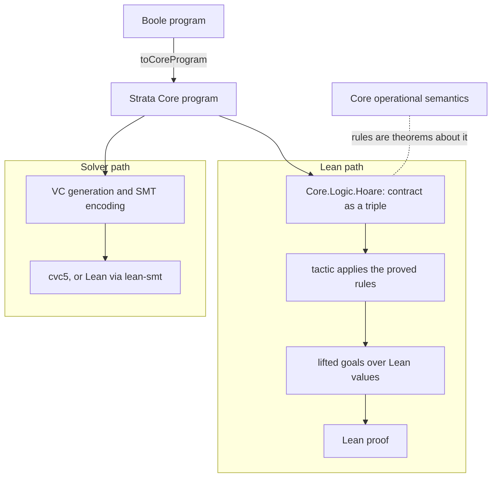

# Verifying Boole programs in Lean

## Goal

Verify Boole programs in Lean with proofs that are sound by construction. Today's Lean
path, `gen_smt_vcs_boole`, trusts the VC generator, the SMT encoding and a bridge axiom;
strata-org/Strata#1488 showed it could prove `False`, and strata-org/Strata#1490 closed
that by refusing every VC the denotation does not cover. This route aims to trust only
Core's semantics and Lean (see Trusted base). Its goals range over Lean values, so Lean
tactics work on them without a solver. Boole programs reach it through their lowering to
Core.

## What Strata provides

`Strata/Languages/Core/Logic/` is a Hoare logic for Core over Core's own operational
semantics:

- `Triple π params Pre ss Post factory`, quantified over every model of `factory`
  (`Lambda.Interp`). A model satisfies the factory's axioms. One is shown to exist for
  Core's own factory (`Core.factoryInterp`: maps as functions, sequences as lists, sets as
  predicates), none for a program's.
- Proved rules: `cmd`, `set`, `init`, `seq`, `block`, `exit_cons`, `ite`, `while_rule`
  (partial correctness) and `Procedure.call_of_contract`.
- `Procedure.contractTriple`: `requires` and `ensures` as the triple to prove, with `old`
  snapshots and typed parameters and clauses. Its factory is Core's operators plus the
  functions declared before the procedure, with or without body
  (`Program.factoryBeforeProcedure`). Datatype declarations add nothing to it, and the
  program's axioms are not in the precondition.
- Strata's notion of correctness, `ProcedureAssertsValidOnTraces.denote`: every assertion
  on every run is valid and the postconditions hold, from entry environments satisfying
  the axioms declared before the procedure (`AxiomsBeforeProcedureDecl`).
  `Strata/Transform/SpecHoareConnection.lean` takes a triple to assertion validity on
  every run, given termination.
- Denotational evaluation (since November 2026): `Expression.eval` is `LExpr.denoteEval`
  over the factory and a model of it, and stores hold semantic values. Lifting lemmas
  exist for `+`, `-`, `*` and the comparisons on `int`, three `bv16` operators, free
  variables, `==` and `if` (`IntEvalProps.lean`, `BitVecEvalProps.lean`), with a generic
  one for any binary operator that has a concrete evaluation (`eval_app2_op`).

Its tests prove some twenty procedures by hand, with `native_decide` for facts about the
AST; none uses axioms, datatypes, maps or sequences. There is no automation and its
authors plan none: the triple is their specification of partial correctness, and
generating verification conditions against it is open to others. So the tactic is ours to
build, on a stable target.

## Plan

1. **Tactic.** State the contract triple with `AxiomsBeforeProcedureDecl` added to its
   precondition, so the axioms are available as Strata's notion of correctness assumes
   them. A theorem to write takes a proved triple to the part of that notion about runs
   that finish; the part about runs that do not also needs termination. Apply the rules
   backwards and discharge their side conditions: `exitsCoveredByBlocks`, and `PostWF` for
   a block that declares nothing, by evaluation on the concrete AST; `PostWF` for a block
   with declarations from `denoteEval_congr`, since a postcondition does not read the
   variables the block drops; and for a call `bodyFrame` and `bodyOutputsTyped`, which are
   facts about every run of the callee's body. The rules for `assume`, `assert`, `havoc`
   and a declaration without initialiser are in strata-org/Strata#1498. The result is one
   goal per `assert`, loop invariant and `ensures`, over the store. This is `core_vcgen`
   of the `StrataBoole/Deep/` experiment (fork branch `exp/deep-embedding`), retargeted to
   Strata's `Triple`.
2. **Lifting.** Turn each goal into a proposition over Lean values: a store slot of type
   `int` is an `Int`, and evaluating an operator on values is the Lean operation. Done:
   Strata's lemmas, plus `Bool.And`, `Bool.Or` and `==` on integers in
   `StrataBoole/HoareLift.lean`. To write: the other Boolean connectives, `div` and `mod`,
   the `bv` operators and conversions, `Map` and `Sequence` operators (from the factory
   axioms), quantifiers, and user functions (a function equals its body in every model).
   This is `core_lift` of the same experiment.
3. **Boole entry.** `Strata.Boole.typeCheck` gives the type-checked Core program of a
   `#strata program Boole` block as a Lean term, and the triple is stated on its
   procedures, as in `hoare_max2.lean`. The prototype's `shallow_reflect` (fork branch)
   wraps this as a command.
4. **The model, in Strata.** Not needed to prove a triple, needed to trust one.
   - Datatypes: constructors, testers and destructors enter the visible factory
     (`Lambda.genBlockFactory` generates them), and the model's datatype laws, today
     disjointness and injectivity, gain inversion and induction.
   - A model exists for a program's factory with its axioms, built on the carrier
     (Decisions). This rules out a vacuous triple, and proves the `nat` bridge axioms of
     the intended `nat` instead of assuming them.
   - `contractTriple` and `call_of_contract` carry the axioms, so a callee's proof may
     use them.
   - Function preconditions and termination of recursive functions, which the solver path
     checks, stated beside the triple.
   - Rules for nondeterministic `if` and `while`.
5. **Boole semantics.** A Boole interpreter proved to agree with `toCoreProgram`, so that
   Boole has a meaning in its own terms and the lowering is proved, not trusted. It
   follows steps 1 to 3 because the agreement theorem needs Core's semantics on the other
   side. It is not for running programs; Strata's `StatementEval.lean` does that. Its
   prerequisites are merged (strata-org/Strata-Boole#25, #26). Candidate: Velvet's
   nondeterministic state monad with its VC generator.

Milestones: `max2`, the counting loop of `demo.lean`, a loop over a sequence, `find_max`,
then the benchmark below.

## Decisions

- Build on `Core.Logic.Hoare`, not on a semantics of our own. `Deep/`'s `Exec` is not
  connected to Core's semantics, and an interpreter with an adequacy proof would redo what
  Strata's rules already prove.
- Core first, then Boole: Core is where the proved semantics lives, so a Boole semantics
  has something to agree with.
- Goals over Lean values come from lifting, not from a monadic encoding, so
  `Std.Do`/`mvcgen` (`StrataBoole/Shallow/Layer.lean`) is off the path.
- Failure is never vacuous: a construct the tactic cannot handle leaves its goal open.
- Datatypes: keep Strata's approach of stating their laws as conditions on every model,
  and supply the model from one generic carrier, a single inductive of constructor
  applications with a well-sortedness predicate (`DT.Carrier`, strata-org/Strata#1493,
  written for the SMT denotation). `nat` is its `pos`/`nat` with `toInt` by structural
  recursion. The per-program inductives of strata-org/Strata#1480 serve the SMT path only;
  readable goals are notation added later.
- This is a deep embedding with shallow goals: the program stays data, and the user sees
  goals over Lean values. The `Shallow` names in the tree are the earlier prototype's.

## Coverage

| Core | State |
| --- | --- |
| assignments, `init` with a value, blocks, `exit`, deterministic `if` and `while`, `call` | rules exist |
| `assert`, `assume`, `havoc`, declaration without initialiser | rules in strata-org/Strata#1498 |
| `if *`, `while *`, loop measures, `cover` | to add |
| `int`, `bool`, `bv n` | lifted: `+`, `-`, `*` and comparisons on `int`, `&&`, `\|\|`, three `bv16` operators; the rest to add (step 2) |
| `Map`, `Sequence`, `Set`, `string` | constrained in every model; lifting to add (step 2) |
| functions, with or without body | in the model |
| `axiom` | through `AxiomsBeforeProcedureDecl` (step 1); assumed until step 4 |
| datatypes, `nat` | not in the model: constructors are unconstrained symbols (step 4) |

## Target: `dalek_sum_of_slice`

`StrataBooleTest/dalek_sum_of_slice.lean` (branch `demo/dalek-sum-of-slice`; 36
obligations on the solver path, cvc5 and lean-smt) is the program this route has to reach.
On the current Strata it type checks, both procedures pass `contractChecksTyped`, every
operator of their specifications is in the visible factory, and caller and callee see the
same factory, as `call_of_contract` requires.

It uses a `for` loop with six invariants and a `call` in its body, `exit`, `assume` and
two declarations without initialiser (step 1); integer `+`, `-`, `*`, `div`, `mod`, `<=`
and `<`, `&&` and `==>`, `<=` on `bv W8` and `as_uint`, `Sequence` `select`, `select!` and
`length`, quantified clauses, and thirteen functions, one recursive and two without body
(step 2); and 19 axioms, 12 from the `nat` library and 7 of its own. `nat` is used only
through its library functions and those axioms, so the proof is expected to need no
datatype reasoning. It does not wait on step 4; until then it assumes the 19 axioms, as
the solver path does.

The callee is trusted: its body is `assume false`. Core's semantics runs the callee's body
at a call, so that assumption enters the caller's trace, and every obligation of the
caller after the first call holds vacuously. On this route a trusted procedure needs a
body that can run and meets its contract, such as assigning an arbitrary value and
assuming the `ensures`. That is a change to the benchmark and to how trusted functions
are translated, not to Strata.

Lifted goals must stay within what lean-smt closes (`Int`, `Bool`, `BitVec`): sequences
lift to a length and an index function, which is what the axioms give in an arbitrary
model, and `nat` appears through `nat.toInt`.

## Trusted base

What a proved triple rests on, beyond Lean's kernel, Core's semantics and the contract as
written:

| Trusted today | Removed by |
| --- | --- |
| the Boole to Core lowering | step 5 |
| the program's axioms, and that a model of the program with them exists | step 4 |
| function preconditions and termination, which the triple does not state | step 4 |
| the Lean compiler, through `native_decide` on facts about the AST | kernel-checked facts in the tactic |

The solver path trusts the lowering and the axioms too, and in addition Strata's
transformation pipeline, the SMT encoding and the solver. The tactic needs no adequacy
theorem: it builds a proof from rules that are theorems about the semantics, and the
kernel checks that proof for each program.

## Status

- `max2` is proved against Strata's triple by hand (`StrataBooleTest/hoare_max2.lean`):
  `contractTriple_of_core_typed`, then `block`, `block`, `ite` and `set`, side conditions
  by `native_decide`, operators lifted with Strata's lemmas and
  `StrataBoole/HoareLift.lean`. It is the specification of the tactic for straight-line
  bodies with `if`. The tactic is not started; `Deep/` has one against its own semantics,
  with `max2` and a counting loop.
- What the hand proof settled: under the module system, facts about factory entries need
  `import all` and `simp`, not `rfl`. Typing derivations no longer have to be written:
  Strata's lemmas take the evaluation of the subterms.
- Risk: discharging the side conditions is the bulk of step 1. Strata's hand proof of a
  two-branch `if` is some 25 lines, its call test some 1400 lines for three procedures.
- `StrataBooleTest/generic_datatypes.lean` is a first prototype of the carrier.
  `StrataBoole/Shallow/Layer.lean` is kept until the first milestone.

## Strata changes for this route

This branch pins the `integration/lean-route` branch of the fork: Strata main plus the open
pull requests below. The pin returns to strata-org/Strata when they merge.

| Change | State | Used by |
| --- | --- | --- |
| strata-org/Strata#1498: rules `init_nondet`, `havoc`, `assume`, `assert`, and the forms of the last two that read a condition by evaluation | open | step 1 |
| strata-org/Strata#1492: public unfolding lemmas for quantifiers and binders | approved, not merged | quantifier lifting in step 2 |
| strata-org/Strata#1493: datatypes in the SMT denotation, with the generic carrier | open | the SMT path now, the model of step 4 later |
| strata-org/Strata#1496: `Map` and `Sequence` statements had no execution, and models did not have to satisfy their axioms | closed, fixed upstream by the denotational evaluation | step 2 |
| strata-org/Strata#1490: the SMT path refuses the VCs its denotation does not cover | merged | Goal |

The integration branch also carries strata-org/Strata#1483, which concerns the solver path
only. Nothing of step 4 has a pull request yet; its shape is the last two open questions.

## Open questions

- Termination: `while_rule` is partial correctness, while Strata's notion of correctness
  also covers runs that never finish. Add a total-correctness rule, or check `decreases`
  separately?
- `cover` is a reachability check, not a Hoare fact. How to state it?
- Goal names: carry the program's clause names into the goals the tactic leaves.
- Datatypes and program models in the Hoare logic (step 4): no upstream test uses either,
  so agree the shape with Strata before building.
- Trusted procedures: `Triple` runs a callee's body, while Strata also has a
  contract-based call semantics (`EvalCmdExtContractE`). Should a triple over it exist?

## Sources

- [Velvet (CAV'26)](https://ilyasergey.net/assets/pdf/papers/velvet-cav26.pdf)
- [Foundational Multi-Modal Program Verifiers (Loom, POPL'26)](https://ilyasergey.net/assets/pdf/papers/loom-popl26.pdf)
- [ilyasergey/lean-vcgen-tutorial](https://github.com/ilyasergey/lean-vcgen-tutorial)
