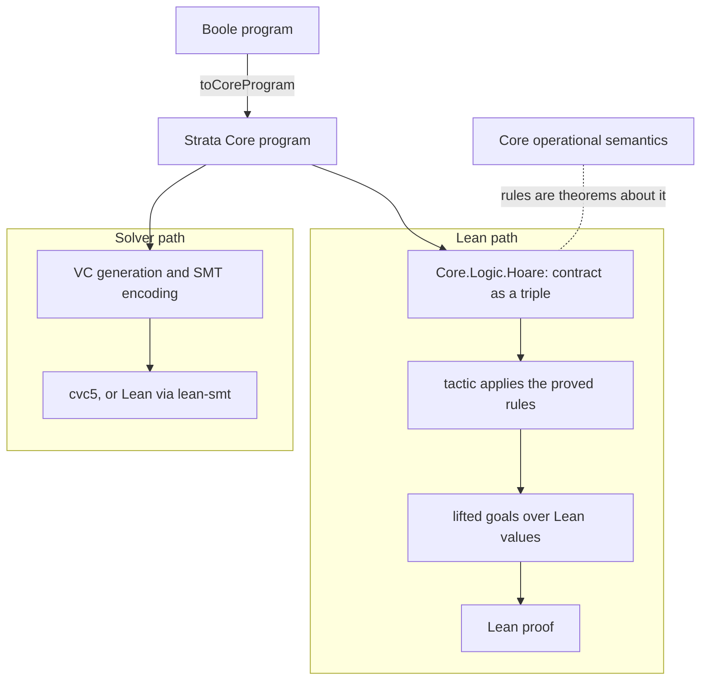

# Verifying Boole programs in Lean

## Goal

Verify Boole programs in Lean with proofs that are sound by construction. Today's Lean
path trusts the VC generator, the SMT encoding and a bridge axiom; strata-org/Strata#1488
showed it could prove `False`, and strata-org/Strata#1490 closed that by refusing every
VC the denotation does not cover. Here the trusted parts are Core's semantics and Lean, and the
goals range over Lean values, so Lean tactics work on them without a solver. Boole programs
reach it through their lowering to Core.

## What Strata already provides

`Strata/Languages/Core/Logic/` (on Strata `main` since September 2026) is a Hoare logic for
Core over Core's own operational semantics:

- `Core.Logic.Hoare.Triple π params Pre ss Post`, quantified over every model of the
  program's uninterpreted symbols (`Lambda.Interp Core.Factory`).
- Proved rules for `cmd`, `set`, `init`, `seq`, `block`, `exit_cons`, `ite`, `while_rule`
  (partial correctness) and `Procedure.call_of_contract`.
- `Procedure.contractTriple`, which reads `requires` and `ensures` as the triple to prove,
  with `old` snapshots and typed parameters, and the generic `SpecHoareConnection`
  (`Strata/DL/Imperative/Logic/`), which relates a triple to Strata's own notion of
  assertion validity.
- Conditions are interpreted with `LExpr.denote`; statements evaluate expressions with
  `Expression.eval` over `Core.Factory`.

Its tests prove some twenty procedures by applying the rules by hand, with `native_decide`
for facts about the AST. There is no automation and no lifting: a goal reads
`Expression.eval ρ.factory ρ.store e = some v`, not `x ≥ y`.

Its authors confirmed (October 2026) that the triple was written as the specification of
partial correctness, the invariant a correct program transformation must preserve, and
that they have no plans to automate it. Generating verification conditions against it is
open to others, and they see no blocker once the generator's correctness is established.
So the tactic below is ours to build, and the triple is a stable target.

## Plan

1. **VC generation tactic over `Core.Logic.Hoare`.** From `Procedure.contractTriple p params
   name`, apply the rules backwards statement by statement and discharge their side
   conditions (`InitEnvWF`, `PostWF`, `exitsCoveredByBlocks`) by evaluation on the
   concrete AST. The result is one goal per `assert`, loop invariant and `ensures`, over
   the store. This is the shape of `core_vcgen` in the `StrataBoole/Deep/` experiment (fork
   branch `exp/deep-embedding`), retargeted from its own `Exec` to Strata's `Triple`.
2. **Lifting.** Turn each goal into a proposition over Lean values: a store slot of type
   `int` is an `Int` (`inputAsPredicate` gives the literal), `Expression.eval` of an
   operator on literals is the Lean operation (one lemma per operator, none in Strata yet),
   and a contract clause under `denote` becomes the corresponding proposition. This is
   the shape of `core_lift`. The interpreter prototype's `Model.lean` and `Sort.lean`, a
   concrete interpretation of Core's types and operators over `LExpr.denote`, carry over
   as this layer. Milestone: `max2`, then the counting loop of `demo.lean`, proved by the
   tactic, lifting, and `omega`/`grind`; `find_max` once `Map` is in (see Risks).
3. **Boole entry.** The prototype's `shallow_reflect` (on its fork branch) already produces
   the type-checked Core program as a Lean term. It is the input of step 1, so a user
   writes a `#strata program Boole` block and states `contractTriple` on its procedures.
4. **Gaps shared with Strata, fixed in Strata.** Rules for nondeterministic `if` and
   `while`; the program's own declarations in the model, that is its functions (with
   bodies, recursive ones included), its uninterpreted functions and its axioms, which
   `Triple` does not see today; the generic datatype carrier wired into the model
   (decision below), which also covers `nat`; `Map` and `Sequence` (see Risks).
5. **Boole semantics.** A Boole interpreter proved to agree with `toCoreProgram`, so that
   Boole has a meaning stated in its own terms and the lowering to Core is proved correct
   rather than definitional. This is what makes Boole a language rather than a front end.
   It comes after steps 1 to 3 because the agreement theorem needs Core's semantics on the
   other side. Its prerequisites, `toCoreExpr` total and the `nat` library inside
   `typeCheck`, are merged (strata-org/Strata-Boole#25, #26). Running programs is not
   what it is for: Strata already has an executable evaluator for Core
   (`Strata/Languages/Core/StatementEval.lean`). Open design choice: Velvet's
   nondeterministic state monad, with its VC generator, is a candidate for the
   interpreter now that Strata and Velvet share a Lean version.

## Decisions

- Build on `Core.Logic.Hoare`, not on a semantics of our own: neither `Deep/`'s `Exec`,
  which nothing connects to Core's semantics, nor an interpreter with an adequacy proof
  that would redo what Strata's rules already prove.
- Core first, then Boole. Boole is the language users write and the one this work is
  about; Core is where the proved semantics lives today. Starting from Boole directly
  would leave nothing to prove adequacy against, so the Boole semantics is step 5, not
  step 1.
- Goals over Lean values come from lifting, not from a monadic encoding, so
  `Std.Do`/`mvcgen` (`StrataBoole/Shallow/Layer.lean`) is off the path.
- Failure is never vacuous: a construct the tactic cannot handle leaves the goal open
  instead of closing it.
- Datatypes get one generic model, not one Lean inductive per program: a single inductive
  of constructor applications with a well-sortedness predicate (`DT.Carrier` in
  `Strata/DL/SMT/DenoteDatatypes.lean`, the SMT denotation under review in Strata). Its laws
  are proved once, a program's datatypes are declarations the model reads, and `nat` is
  its `pos`/`nat` with `toInt` by structural recursion. The same carrier interprets
  datatype sorts in the model `Triple` quantifies over, which discharges the laws the
  Lambda denotation leaves as assumptions. The per-program inductives of
  strata-org/Strata#1480 serve the SMT-IR path; readable goals (`pos.xO h` for
  `mk "xO" [h]`) are notation and simp lemmas added later.
- This is a deep embedding with shallow goals: the program stays data, the Lean term is
  the proof about it, and what the user sees are goals over Lean values. It started as a
  shallow embedding in the Velvet sense; say so when the difference matters. The
  `Shallow` names left in the tree (`StrataBoole/Shallow/`, `shallow_find_max`) are that
  prototype's.

## Coverage of the rules

| Core | `Core.Logic.Hoare` |
| --- | --- |
| assignments, `init`, `assert`, `assume`, `havoc` (as `set x *` through `cmd`), blocks, `exit`, deterministic `if` and `while`, `call` | rules exist |
| `if *`, `while *`, loop measures, `cover` | to add |
| `int`, `bool`, `bv n` | denoted; lifting lemmas to add (step 2) |
| `Map`, `Sequence`, `string` operators | not usable yet: no value forms in the evaluator, and the triple quantifies over models that need not satisfy their axioms (see Risks) |
| datatypes, `nat` | generic carrier (decision above); wiring into the model is step 4 |
| user functions | step 4, Strata's TODO on the model factory |

## Target: the benchmark the solver path already verifies

`StrataBooleTest/dalek_sum_of_slice.lean` (36 obligations, cvc5 and lean-smt) is the
program this route has to reach. What it uses, and where each item sits:

| In the program | Needs | Step |
| --- | --- | --- |
| `for` loop with six invariants, `call` in the body, `exit` | rules exist; the tactic must discharge the loop and call side conditions | 1 |
| integer and `bv W8` arithmetic, `as_uint`, comparisons | lifting lemmas per operator | 2 |
| quantified `requires` and invariants | lifting of `denote` on quantifiers to Lean `∀` over `Int` | 2 |
| `Sequence (bv W8)` and `Sequence Scalar`, `select`, `length` | a model and value forms in Strata | 4 |
| native `nat`, the `nat_*` library | the generic carrier in the model, library functions as program functions | 4 |
| `function` definitions, one `rec function` with `requires` and `decreases`, `function f();` without body | program declarations in the model | 4 |
| `axiom` declarations, including the unfolding axiom of the recursive function | program axioms as hypotheses on the model | 4 |
| a callee whose body is `assume false` | `call_of_contract` with a trivially proved contract | 1 |

The lifted goals must stay solver-friendly: lean-smt closes goals over `Int`, `Bool` and
`BitVec`, so sequences should lift to a length and an index function rather than to
`List`, and `nat` to `Nat`. Decide this with step 4; it does not affect steps 1 to 3.

Order: `max2`, the counting loop, then this program as soon as step 4 lands in Strata.
Everything in steps 1 to 3 is exercised by the first two and reused unchanged by the third.

## Status

- Steps 1 and 2: not started against Strata's triple. `Deep/` has both against its own
  semantics, with `max2` and a counting loop proved.
- `StrataBoole/Shallow/Layer.lean` is kept until the milestone is reached.
- `StrataBooleTest/generic_datatypes.lean`: first prototype of the carrier.
- Risks. Strata's own hand proof of a two-branch `if` is some twenty-five lines with
  `native_decide` and explicit store facts, so discharging the side conditions
  automatically is the bulk of step 1. Step 4 also waits on Strata carrying the
  typed-contract invariant as a hypothesis of `contractTriple`.
- `Map` and `Sequence` are outside the Hoare logic today, for two reasons that both
  need a Strata change. First, `set` and `init` require `Expression.eval` to return a
  value, and `evalFully` returns `none` for a full application of an operator without a
  concrete evaluation (`select`, `update`, the sequence and string operators), so
  `x := m[0]` has no execution and its triple holds for any postcondition. Second,
  `Triple` quantifies over every `Lambda.Interp`, which must agree with function bodies
  and concrete evaluations but not with the factory axioms, so nothing about
  `m[k := v][k]` is provable in any case. The fix is to give these operators a fixed
  interpretation in the model (maps as functions, sequences as lists) together with
  value forms for the evaluator, or to interpret `set` and `init` through `denote`.
  `Strata/Languages/Core/ProgramEval.lean` already has the evaluation of `select` over
  `update`/`mapConst` terms for the concrete interpreter. Until this lands the tactic
  refuses such statements, and the milestone is an integer program with a loop
  (`demo.lean`'s), not `find_max`.

## Open questions

- Loop measures: `while_rule` is partial correctness. Add a total-correctness rule, or
  check `decreases` separately?
- `cover` is a reachability check, not a Hoare fact. How to state it?
- Goal names: carry the program's clause names into the goals the tactic leaves.
- Evaluator vacuity (see Risks): evaluation rules for `Map` and `Sequence` operators, or
  `set`/`init` through `denote`? The second keeps one interpretation for expressions
  everywhere; the first keeps Strata's semantics unchanged.
- `native_decide` for AST facts: acceptable in the tactic, or avoid it?

## Sources

- [Velvet (CAV'26)](https://ilyasergey.net/assets/pdf/papers/velvet-cav26.pdf)
- [Foundational Multi-Modal Program Verifiers (Loom, POPL'26)](https://ilyasergey.net/assets/pdf/papers/loom-popl26.pdf)
- [ilyasergey/lean-vcgen-tutorial](https://github.com/ilyasergey/lean-vcgen-tutorial)
