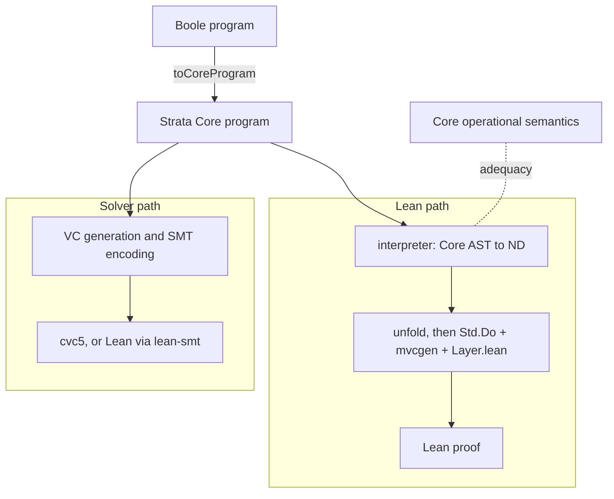

# Shallow embedding of Strata in Lean

The goal is to verify Boole programs in Lean with proofs that are sound by construction.
Today's Lean path trusts the VC generator, the SMT encoding and a bridge axiom
(strata-org/Strata#1488 shows it can prove `False`). Here the only trusted parts are Core's
semantics and Lean, and the verification conditions range over Lean values, so Lean tactics
work on them directly, without a solver. Boole programs reach it through their lowering to
Core.

## Plan

The steps, in order. Each one is a theorem or a tool on the branch, not a design choice
left open.

1. **Interpreter.** One Lean function, `interpProc M p σ`, gives every Core procedure `p`
   its meaning in the `ND` monad of `Layer.lean`, from a store `σ` and parametric in a model
   `M` of Core's types and operators (`StrataBoole/Shallow/Interpreter/`). It keeps the
   Core AST as data, evaluates expressions with Strata's own `LExpr.denote`, and has no
   second evaluator. Unfolding it on a concrete program yields the monadic term that
   `mvcgen` works on; this is what "shallow" refers to. There is no per-program translator:
   a generated program would be a second meaning of the source that nothing checks.
2. **Adequacy.** Prove that the interpreter agrees with Core's operational semantics
   (`Imperative/StmtSemantics.lean` and `CmdSemantics.lean`, instantiated for Core in
   `Core/StatementSemantics.lean`): if Core runs `s` from `σ` to `σ'` without a failure,
   then `some σ'` is an outcome of `interpStmts s σ`, and if a check fails along the way,
   `none` is. Core records a failed check in a flag and keeps running, while `ND` stops,
   which the statement accounts for. Core's semantics evaluates expressions with Strata's
   evaluator `LExpr.eval`, the interpreter with `LExpr.denote`; the two are related by
   `eval_denote_sound` (`LExprSemanticsConsistent.lean`). This theorem is what makes the
   Lean path trustworthy. Everything the interpreter does
   not cover must fail, never be vacuous, so that a missing case cannot prove a
   specification.
3. **Proof rules and tactic.** `Layer.lean` already has the rules (`havoc_spec`,
   `assume_spec`, `assert_spec`, `whileInv_spec`, each a proved `@[spec]` theorem) and
   `mvcgen` is the tactic that applies them. The first program proved end to end through
   the interpreter, `find_max`, is the milestone for this step: `shallow_reflect`, unfold
   `interpProc`, `mvcgen`, then `grind`/`omega`. Improvements such as goal names that
   follow the program's clauses, `decreases` checks and Core notation in goals go on top
   of `mvcgen`, not into a separate semantics.
4. **Model.** Results must hold for every interpretation of Core's types and operators
   that is consistent with Core, not for one concrete model. How datatypes and `nat` fit
   this is decided when steps 1 to 3 are done; `shallow_generic_datatypes.lean` is a first
   prototype.
5. **Boole semantics.** A Boole interpreter proved to agree with the Core one on
   `toCoreProgram p`, so that Boole gets a semantics of its own and the lowering is
   verified. This needs `toCoreExpr` total and the `nat` library added inside `typeCheck`,
   which are strata-org/Strata-Boole#25 and #26.

## Decisions

- **Input is Core**, which has a formal semantics, so the interpretation can be proved
  adequate against it. Boole and other front ends lower to Core.
- **Interpreter, not translator.** See step 1.
- **Framework: `Std.Do` and `mvcgen`**, available in Lean 4.29 and 4.31. Lean marks
  `mvcgen` experimental; its successor `vcgen` needs Lean 4.33. If `mvcgen` misbehaves
  on a construct, the fix is a minimal example and a workaround, not a replacement VC
  generator over a second semantics.
- **No Velvet dependency:** Velvet needs Lean 4.34.
- **Failure is an outcome.** A failed `assert`, an unsupported statement or an ill-typed
  expression is the `none` outcome (`ND.fail` in the interpreter), which no specification
  admits.

## Mapping

| Core | Lean |
| --- | --- |
| assignments, `if`, locals | `do` notation |
| `exit`, labeled or not | to do |
| `while` without a measure, `havoc`, `assume`, `assert` | `Layer.lean` |
| `if *` | a `havoc` of the condition |
| `while` with a measure, `while *` | to do |
| `call` | to decide: the callee's specification, or its body |
| `in`, `inout`, `out` parameters (Boole's globals and `modifies` become these) | store entries; an `out` starts arbitrary, an `inout` keeps its input |
| `int`, `bool`, `nat`, `bv n`, `Sequence`, `Map` | `Int`, `Bool`, `Nat`, `BitVec n`, `List`/`Array`, functions |
| datatypes | see step 4 |
| `cover`, local function and type declarations | to do |

## Status

- `StrataBoole/Shallow/Layer.lean`: the `ND` monad with `havoc`, `assume`, `assert` and a
  `while` loop carrying its invariant, each with a proved rule.
  `StrataBooleTest/shallow_find_max.lean` verifies three hand-written programs with it and
  fixes the form the interpreter should produce after unfolding.
- `StrataBoole/Shallow/Interpreter/` (on a fork, to be merged here): the interpreter of
  step 1, with reflection of the type-checked Core program into a Lean term
  (`shallow_reflect`). Not yet: calls, `exit`, nondeterministic loops, measures,
  materialization of the unfolded term, and the end-to-end example of step 3.
- `StrataBooleTest/shallow_generic_datatypes.lean`: a first prototype for step 4.
- Step 2 and step 5 are not started.

## Open questions

- **Execution:** `ND` is a set of outcomes, so it cannot run programs; Velvet's monad can.
- **`assume`:** in Boogie an impossible `assume` makes the path vacuous; Velvet's choice
  operator instead requires proving that a value exists. `Layer.lean` follows Boogie.
- **Reads:** a checked read needs an `assert` or Lean's `a[i]'h`. Core leaves an
  out-of-range `select!` unconstrained, while Lean's `a[i]!` returns a default value,
  which proofs must not rely on.
- **Goal names:** `mvcgen` numbers the goals; they should carry the program's clause names.
- **Axioms:** a program's axioms become either Lean axioms, which are trusted, or
  hypotheses of each theorem.
- **`cover` and frames** have no counterpart in Velvet. Frames follow from Core's
  `in`/`inout` parameters. `cover` checks that some path reaches it with its condition
  true, which is not a weakest-precondition fact.

## Sources

- [Velvet (CAV'26)](https://ilyasergey.net/assets/pdf/papers/velvet-cav26.pdf)
- [Foundational Multi-Modal Program Verifiers (Loom, POPL'26)](https://ilyasergey.net/assets/pdf/papers/loom-popl26.pdf)
- [verse-lab/velvet](https://github.com/verse-lab/velvet)
- [ilyasergey/lean-vcgen-tutorial](https://github.com/ilyasergey/lean-vcgen-tutorial)
