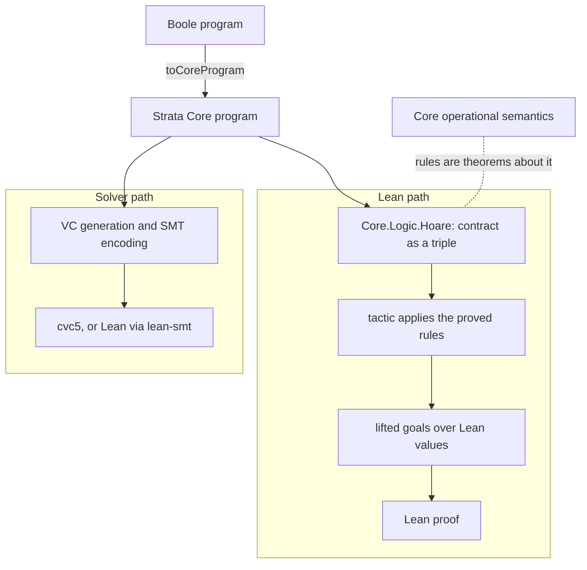

# Verifying Boole programs in Lean

## Goal

Verify Boole programs in Lean with proofs that are sound by construction. Today's Lean
path trusts the VC generator, the SMT encoding and a bridge axiom, and strata-org/Strata#1488
shows it can prove `False`. Here the trusted parts are Core's semantics and Lean, and the
goals range over Lean values, so Lean tactics work on them without a solver. Boole programs
reach it through their lowering to Core.

## What Strata already provides

`Strata/Languages/Core/Logic/` (on Strata `main` since September 2026) is a Hoare logic for
Core over Core's own operational semantics:

- `Core.Logic.Hoare.Triple π params Pre ss Post`, quantified over every model of the
  program's uninterpreted symbols (`Lambda.Interp Core.Factory`).
- Proved rules for `cmd`, `set`, `init`, `seq`, `block`, `exit`, `ite`, `while_rule`
  (partial correctness) and `call_of_contract`.
- `Procedure.contractTriple`, which reads `requires` and `ensures` as the triple to prove,
  with `old` snapshots and typed parameters, and `SpecHoareConnection`, which relates the
  triple to Strata's own notion of assertion validity.
- Conditions are interpreted with `LExpr.denote`; statements evaluate expressions with
  `Expression.eval` over `Core.Factory`.

Its tests prove eleven procedures by applying the rules by hand, with `native_decide`
for facts about the AST. There is no automation and no lifting: a goal reads
`Expression.eval ρ.factory ρ.store e = some v`, not `x ≥ y`.

Its authors confirmed (October 2026) that the triple was written as the specification of
partial correctness, the invariant a correct program transformation must preserve, and
that they have no plans to automate it. Generating verification conditions against it is
open to others, and they see no blocker once the generator's correctness is established.
So the tactic below is ours to build, and the triple is a stable target.

## Plan

1. **VC generation tactic over `Core.Logic.Hoare`.** From `Procedure.contractTriple p params
   name`, apply the rules backwards statement by statement and discharge their side
   conditions (`InitEnvWF`, `PostWF`, `exitsCoveredByBlocks`) by evaluation on the
   concrete AST. The result is one goal per `assert`, loop invariant and `ensures`, over
   the store. This is the shape of `core_vcgen` in `StrataBoole/Deep/` (branch
   `exp/deep-embedding`), retargeted from its own `Exec` to Strata's `Triple`.
2. **Lifting.** Turn each goal into a proposition over Lean values: a store slot of type
   `int` is an `Int` (`inputAsPredicate` gives the literal), `Expression.eval` of an
   operator on literals is the Lean operation (`eval_intGe_value_of_numerals` and its
   siblings exist; the missing operators are added), and a contract clause under
   `denote` becomes the corresponding proposition. This is the shape of `core_lift`.
   Milestone: `max2`, then `find_max`, proved by the tactic, lifting, and `omega`/`grind`.
3. **Boole entry.** `shallow_reflect` already produces the type-checked Core program as a
   Lean term; it is the input of step 1, so a user writes a `#strata program Boole` block
   and states `contractTriple` on its procedures.
4. **Gaps shared with Strata, fixed in Strata.** Rules for nondeterministic `if` and
   `while` (today only the deterministic forms have rules); user-defined functions in the
   model (Strata's own TODO); a denotation for datatypes, which is strata-org/Strata#1480
   and is also what makes Boole's `nat` provable.
5. **Boole semantics.** A Boole interpreter proved to agree with `toCoreProgram`, so Boole
   gets a semantics of its own. Needs `toCoreExpr` total and the `nat` library inside
   `typeCheck`, both merged (strata-org/Strata-Boole#25, #26). Later.

## Decisions

- Build on `Core.Logic.Hoare`, not on a semantics of our own: neither `Deep/`'s `Exec`,
  which nothing connects to Core's semantics, nor an interpreter with an adequacy proof
  that would redo what Strata's rules already prove.
- Core first, then Boole. Starting from Boole directly would leave nothing to prove
  adequacy against.
- Goals over Lean values come from lifting, not from a monadic encoding, so
  `Std.Do`/`mvcgen` (`StrataBoole/Shallow/Layer.lean`) is off the path.
- Failure is never vacuous: a construct the tactic cannot handle leaves the goal open
  instead of closing it.

## Coverage of the rules

| Core | `Core.Logic.Hoare` |
| --- | --- |
| assignments, `init`, `assert`, `assume`, `havoc` (as `set x *` through `cmd`), blocks, `exit`, deterministic `if` and `while`, `call` | rules exist |
| `if *`, `while *`, loop measures, `cover` | to add |
| `int`, `bool`, `bv n`, `Map`, `Sequence` | denoted; lifting lemmas exist for `Int` comparisons, `+`, `*`, `not` |
| user functions, datatypes, `nat` | step 4 |

## Status

- Steps 1 and 2: not started against Strata's triple. `Deep/` has both against its own
  semantics, with `max2` and a counting loop proved.
- `StrataBoole/Shallow/Interpreter/` and `Layer.lean` are kept until the milestone is
  reached; `shallow_reflect` stays for step 3.
- `StrataBooleTest/shallow_generic_datatypes.lean`: first prototype for step 4.

## Open questions

- Loop measures: `while_rule` is partial correctness. Add a total-correctness rule, or
  check `decreases` separately?
- `cover` is a reachability check, not a Hoare fact. How to state it?
- Goal names: carry the program's clause names into the goals the tactic leaves.
- `native_decide` for AST facts: acceptable in the tactic, or avoid it?

## Sources

- [Velvet (CAV'26)](https://ilyasergey.net/assets/pdf/papers/velvet-cav26.pdf)
- [Foundational Multi-Modal Program Verifiers (Loom, POPL'26)](https://ilyasergey.net/assets/pdf/papers/loom-popl26.pdf)
- [ilyasergey/lean-vcgen-tutorial](https://github.com/ilyasergey/lean-vcgen-tutorial)
