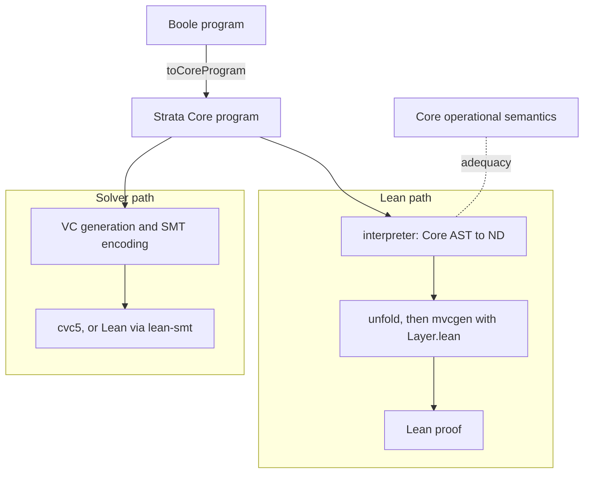

# Shallow embedding of Strata in Lean

## Goal

Verify Boole programs in Lean with proofs that are sound by construction. Today's Lean
path trusts the VC generator, the SMT encoding and a bridge axiom, and strata-org/Strata#1488
shows it can prove `False`. Here the trusted parts are Core's semantics and Lean, and the
goals range over Lean values, so Lean tactics work on them without a solver. Boole programs
reach it through their lowering to Core.

## Plan

1. **Interpreter.** `interpProc M p σ` gives a Core procedure `p` its meaning in the `ND`
   monad of `Layer.lean`, from a store `σ`, for a model `M` of Core's types and
   operators (`StrataBoole/Shallow/Interpreter/`). The Core AST stays data. Expressions
   are evaluated with Strata's `LExpr.denote`, so there is no second evaluator. Unfolding
   the interpreter on a program gives the monadic term that `mvcgen` works on. That term
   is the shallow embedding. There is no per-program translator: a generated program
   would be a second meaning of the source that nothing checks.
2. **Adequacy.** Prove the interpreter agrees with Core's operational semantics
   (`Imperative/StmtSemantics.lean`, `CmdSemantics.lean`, instantiated in
   `Core/StatementSemantics.lean`). If Core runs `s` from `σ` to `σ'` without a failure,
   `some σ'` is an outcome of `interpStmts s σ`; if a check fails on the way, `none` is.
   Two details: Core sets a failure flag and keeps running where `ND` stops, and Core
   evaluates expressions with `LExpr.eval` where the interpreter uses `LExpr.denote`,
   which `eval_denote_sound` relates. Anything the interpreter does not cover must fail,
   so a missing case cannot prove a specification.
3. **Proof rules and tactic.** `Layer.lean` has the rules (`havoc_spec`, `assume_spec`,
   `assert_spec`, `whileInv_spec`, proved `@[spec]` theorems) and `mvcgen` applies them.
   Milestone: `find_max` proved end to end, by `shallow_reflect`, unfolding `interpProc`,
   `mvcgen`, then `grind` or `omega`. Goal names from the program, `decreases` checks and
   Core notation in goals go on top of `mvcgen`, not into a separate semantics.
4. **Model.** Results must hold for every interpretation of Core's types and operators
   consistent with Core, not for one concrete model. Datatypes and `nat` are decided after
   steps 1 to 3; `shallow_generic_datatypes.lean` is a first prototype.
5. **Boole semantics.** A Boole interpreter proved to agree with the Core one on
   `toCoreProgram p`. Needs `toCoreExpr` total and the `nat` library inside `typeCheck`
   (strata-org/Strata-Boole#25 and #26).

## Decisions

- Input is Core, because Core has a semantics to prove adequacy against.
- Interpreter, not translator (step 1).
- `Std.Do` and `mvcgen`, available on Lean 4.29 and 4.31. `vcgen` needs 4.33, Velvet
  4.34. If `mvcgen` misbehaves on a construct, the fix is a minimal example and a
  workaround, not a replacement VC generator over a second semantics.
- Failure is an outcome. A failed `assert`, an unsupported statement or an ill-typed
  expression is the `none` outcome (`ND.fail`), which no specification admits.

## Coverage

| Core | Lean path |
| --- | --- |
| assignments, `if`, `if *`, locals, blocks | interpreter |
| `havoc`, `assume`, `assert`, `while` with invariants | `Layer.lean` |
| `in`, `inout`, `out` parameters (Boole's globals and `modifies` become these) | store entries; an `out` starts arbitrary, an `inout` keeps its input |
| `int`, `bool`, `bv n`, `Map`, `Sequence` | `Int`, `Bool`, `BitVec n`, functions, `List` |
| `exit`, `call`, `while *`, loop measures, `cover`, local functions and types | to do; for `call`, callee's spec or body is to decide |
| datatypes, `nat` | step 4 |

## Status

- `StrataBoole/Shallow/Layer.lean`: the `ND` monad and the rules.
  `StrataBooleTest/shallow_find_max.lean` verifies three hand-written programs with it, in
  the form the interpreter should produce after unfolding.
- `StrataBoole/Shallow/Interpreter/` (on a fork, to be merged here): the interpreter and
  `shallow_reflect`, which reflects the type-checked Core program into a Lean term. Missing
  for the step 3 milestone: a `simp` set for `denote` over annotated expressions, and
  metadata stripped from the reflected term.
- `StrataBooleTest/shallow_generic_datatypes.lean`: step 4 prototype.
- Steps 2 and 5 not started.

## Open questions

- `ND` is a set of outcomes, so it cannot run programs; Velvet's monad can.
- `assume`: Boogie makes an impossible `assume` vacuous; Velvet's choice operator requires
  a witness. `Layer.lean` follows Boogie.
- Out-of-range reads: Core leaves `select!` unconstrained, Lean's `a[i]!` returns a
  default. Proofs must not rely on the default.
- `mvcgen` numbers goals; they should carry the program's clause names.
- A program's axioms become Lean axioms, which are trusted, or hypotheses of each theorem.
- `cover` is a reachability check, not a weakest-precondition fact.

## Sources

- [Velvet (CAV'26)](https://ilyasergey.net/assets/pdf/papers/velvet-cav26.pdf)
- [Foundational Multi-Modal Program Verifiers (Loom, POPL'26)](https://ilyasergey.net/assets/pdf/papers/loom-popl26.pdf)
- [verse-lab/velvet](https://github.com/verse-lab/velvet)
- [ilyasergey/lean-vcgen-tutorial](https://github.com/ilyasergey/lean-vcgen-tutorial)
